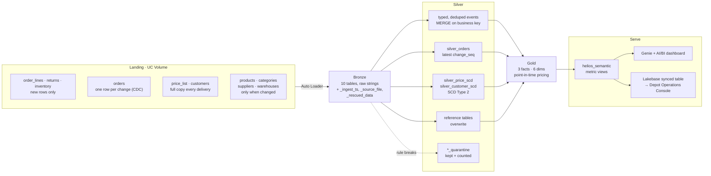
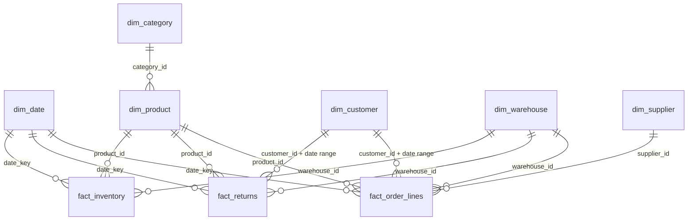
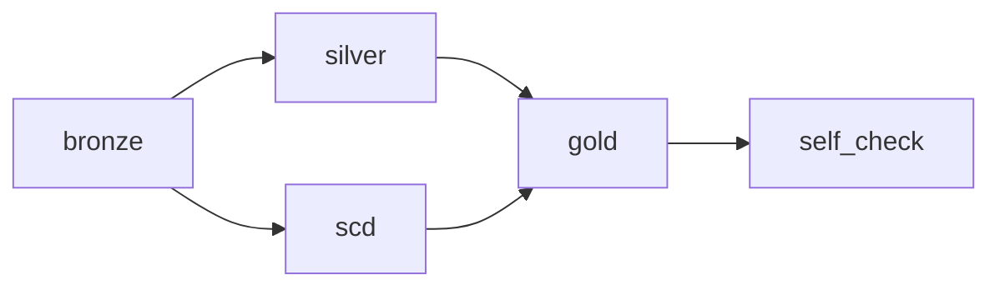
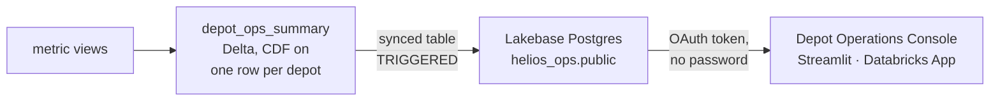

# Helios Trading Lakehouse & Streaming Data Platform

> ✅ **Complete.** Built end to end on Databricks: ingestion, Silver, SCD2 history, Gold star schema, built twice (Lakeflow Jobs and Lakeflow Spark Declarative Pipelines), then served through a semantic layer, Genie, an AI/BI dashboard, Lakebase and a Databricks App.

Order-to-cash platform for **Helios Trading Corporation**, a fictional interplanetary parts distributor in the year 2257 with six depots from Luna to Titan. Data links to the outer depots are unreliable, so duplicated, late and bad rows are part of the design, not an accident. Dates like `2257-03-01` in the data are intentional.

| | |
|---|---|
| **Feeds** | 10 feeds, 3 formats (JSON, CSV, Parquet), 4 arrival patterns |
| **Volume** | ~293,000 order lines across 5 deterministic batches from a synthetic generator |
| **Catalog** | `labs_<user>` with schemas `helios_raw`, `helios_bronze`, `helios_silver`, `helios_gold`, `helios_semantic` |
| **Builds** | Imperative (5-task Lakeflow Job) and declarative (one Lakeflow pipeline), same tables, same answers |
| **Serving** | Metric views → Genie + AI/BI dashboard; curated Gold → Lakebase → Databricks App |

See the [portfolio overview](../README.md) for how this project fits with the others.

---

## Architecture



Design write-up: [`2_4_lakehouse_design.md`](helios-lab/02_design/2_4_lakehouse_design.md) · original diagram: [`2_4_lakehouse_design.png`](helios-lab/02_design/2_4_lakehouse_design.png)

---

## The arrival pattern decides the processing

| Pattern | Feeds | Silver handling |
|---|---|---|
| New rows only | `order_lines`, `returns`, `inventory` | Stream from Bronze, dedupe, MERGE on the business key; rule breakers to quarantine |
| One row per change (CDC) | `orders` | Latest row by `change_seq` (never `change_ts`, which arrives out of order); a `DELETE` purges the order |
| Full copy every delivery | `price_list` (full price history), `customers` (daily snapshot) | SCD Type 2: prices sequenced by `effective_from`, customers by snapshot comparison |
| Only when changed | `products`, `categories`, `suppliers`, `warehouses` | Current-state overwrite |

Feed contracts, samples and schemas: [`2_2_source_feeds.md`](helios-lab/02_design/2_2_source_feeds.md)

---

## Gold star schema



| Fact | Grain | Notes |
|---|---|---|
| `fact_order_lines` | one order line (bookings grain) | Priced at the price version in force at `line_ts`; `gross_amount`, `margin`, `is_returned`, `order_status` |
| `fact_returns` | one return | Refund valued at the price the customer originally paid |
| `fact_inventory` | one stock movement | `delta` is additive, `on_hand` is semi-additive (never summed across time) |

`dim_customer` is SCD Type 2 on tier; there is no Gold price dimension (facts price against `silver_price_scd` and keep `price_sk`). Detail: [`3_5_gold_approach.md`](helios-lab/03_jobs/3_5_gold_approach.md)

---

## What was built, module by module

| Module | Folder | What it delivers |
|---|---|---|
| **Setup** | [`00_setup`](helios-lab/00_setup), [`02_design`](helios-lab/02_design) | Deterministic data generator, catalog and Volume bootstrap, feed contracts, lakehouse design |
| **Imperative build** | [`03_jobs`](helios-lab/03_jobs) | Auto Loader Bronze, `foreachBatch` MERGE Silver, SCD2, Gold, multi-batch replay, one Lakeflow Job |
| **Declarative build** | [`04_lsdp`](helios-lab/04_lsdp) | The same medallion as one Lakeflow pipeline, plus a production incident triaged from the event log |
| **Semantic layer & BI** | [`05_genie_dashboards`](helios-lab/05_genie_dashboards) | Metric views, a Genie Agent and an AI/BI dashboard on one definition of every metric |
| **Operational serving** | [`06_lakebase_app`](helios-lab/06_lakebase_app) | Curated Gold synced to Lakebase, read by a Streamlit Databricks App |
| **Performance** | [`docs/performance_tuning.md`](docs/performance_tuning.md) | AQE, liquid clustering, MERGE pruning, and what applies at Helios scale |

### 1 · Imperative build: Lakeflow Jobs



- **Bronze:** Auto Loader with `addNewColumns`, `_rescued_data`, `availableNow`, one checkpoint and schema location per feed ([`3_2_auto_loader.md`](helios-lab/03_jobs/3_2_auto_loader.md)).
- **Silver:** every column cast explicitly, money as `DECIMAL(12,2)`, `foreachBatch` + MERGE so a replayed micro-batch is a no-op ([`3_3_silver_approach.md`](helios-lab/03_jobs/3_3_silver_approach.md)).
- **History:** SCD Type 2 for prices and customer tiers, contiguous non-overlapping ranges ([`3_4_scd2_approach.md`](helios-lab/03_jobs/3_4_scd2_approach.md)).
- **Orchestration:** five tasks in [`job_tasks/`](helios-lab/03_jobs/job_tasks), `silver` and `scd` in parallel, 2 retries per task, daily schedule, failure email, and a `self_check` task that fails the run if any invariant breaks.

### 2 · Declarative build: Lakeflow Spark Declarative Pipelines

One pipeline, four source notebooks (`bronze`, `silver`, `scd`, `gold`); the engine derives the run order from table references ([`4_3_pipeline_design.md`](helios-lab/04_lsdp/4_3_pipeline_design.md), concepts in [`4_2_lsdp_concepts.md`](helios-lab/04_lsdp/4_2_lsdp_concepts.md)).

| Concept | Used for |
|---|---|
| Streaming tables | 10 Bronze tables (Auto Loader), event Silver tables, quarantine tables |
| Expectations | `fail` on primary keys, `drop` on contract breaks (with a quarantine twin), `warn` on monitored values |
| AUTO CDC, SCD1 | `silver_orders` sequenced by `change_seq`, deletes applied |
| AUTO CDC, SCD2 | `silver_price_versions` sequenced by `effective_from`, conformed by a materialized view |
| AUTO CDC FROM SNAPSHOT | `silver_customer_scd` from the daily customer snapshots |
| Materialized views | Reference tables in Silver and all of Gold |

**Incident drill (HELIOS-411):** an inherited pipeline fails overnight. Diagnosed from the event log to one below-cost price on one product, supplier and day: a real business event, not corrupt data. Fixed by changing the expectation from `fail` to `warn` and re-running clean ([`4_11_lab_fix_incident.py`](helios-lab/04_lsdp/4_11_lab_fix_incident.py)).

### 3 · Semantic layer, Genie and dashboard

Each subject area is a pair: a plain view (`*_vw`) that joins the fact to its dimensions, and a **metric view** (`*_mv`) that defines every measure once ([`5_2_self_serve_analytics.md`](helios-lab/05_genie_dashboards/5_2_self_serve_analytics.md)).

| Metric view | Example measures |
|---|---|
| `sales_mv` | Revenue, Net Revenue, Gross Margin, Gross Margin Rate, Return Rate, Average Order Value, Sold Below Cost |
| `orders_mv` | Orders, Cancellation Rate, On Time Fulfilment Rate, Backordered Orders |
| `inventory_mv` | Units In, Units Out, Net Stock Change, Stockout Events, Min On Hand |

A **Genie Agent** and an **AI/BI dashboard** both read these metric views, so a chart and a plain-English answer can never disagree on revenue.

### 4 · Operational serving: Lakebase + Databricks App

Analytics tolerates seconds; an app needs milliseconds per click ([`6_2_operational_serving.md`](helios-lab/06_lakebase_app/6_2_operational_serving.md)).



- `depot_ops_summary` is built from the metric views, so the console shows the same figures as Genie and the dashboard.
- The app authenticates with short-lived OAuth tokens from `generate_database_credential`; there is no password in the codebase ([`6_3_databricks_apps.md`](helios-lab/06_lakebase_app/6_3_databricks_apps.md), code in [`app/`](helios-lab/06_lakebase_app/app)).
- A Lakebase branch gives a copy-on-write clone of production for safe testing.

---

## Key decisions

| Decision | Instead of | Why |
|---|---|---|
| Processing chosen per arrival pattern | One generic pipeline | Snapshots need comparison, CDC needs sequencing, append needs dedupe |
| Bronze stays raw strings; type once in Silver | Typing at ingestion | A failed cast at ingestion is a silent null; in Silver it is quarantined |
| Order state by highest `change_seq` | `change_ts` or arrival order | `change_ts` arrives out of order |
| Rule breakers quarantined, never dropped | Filtering bad rows out | A dropped row is an unexplainable gap in Gold |
| SCD2 only for prices and customer tier | SCD2 everywhere | History only where the business reports "as it was" |
| Bookings-grain fact with `is_returned` | Netting returns into sales | Last month's revenue never silently changes |
| Metrics defined once as metric views | Aggregate tables per report | One definition for Genie, dashboards and the app |
| Curated summary synced to Lakebase | App queries the SQL warehouse | Keyed reads in milliseconds without warehouse cost per click |

---

## Repository layout

```text
04-helios-trading-platform/
├── README.md
├── docs/
│   └── performance_tuning.md
└── helios-lab/
    ├── 00_setup/              data generator, bootstrap helpers (Genie, Lakebase)
    ├── 02_design/             feed contracts, lakehouse design + diagram, environment setup
    ├── 03_jobs/               imperative build: layer labs, job_tasks/, orchestration
    ├── 04_lsdp/               declarative build: pipeline sources per lab, incident drill
    ├── 05_genie_dashboards/   semantic layer, Genie, AI/BI dashboard
    └── 06_lakebase_app/       Lakebase serving, Databricks App (app/)
```

## Running it

1. Import the repo into a Databricks workspace as a Git folder (Free Edition works; serverless throughout).
2. Run [`2_5_lab_environment_and_data.py`](helios-lab/02_design/2_5_lab_environment_and_data.py) to create the catalog, schemas and landing Volume and land batch one.
3. Run the Section 3 labs in order (`3_7` → `3_12`), or deploy the Job in `3_11` and run it per batch.
4. Rebuild declaratively with the Section 4 labs (`4_5` → `4_8`), then the incident drill `4_11`.
5. Build the semantic layer, Genie and dashboard (`5_3` → `5_5`), then Lakebase and the app (`6_5`, `6_6`).

Every lab ends with a self-check that asserts row counts and invariants, so "it works" is a passing check, not an opinion.

---

**Stack:** Databricks (serverless) · Unity Catalog · Delta Lake · Auto Loader · Structured Streaming · Lakeflow Jobs · Lakeflow Spark Declarative Pipelines (AUTO CDC, expectations) · metric views · Genie · AI/BI dashboards · Lakebase · Databricks Apps · PySpark · Spark SQL
